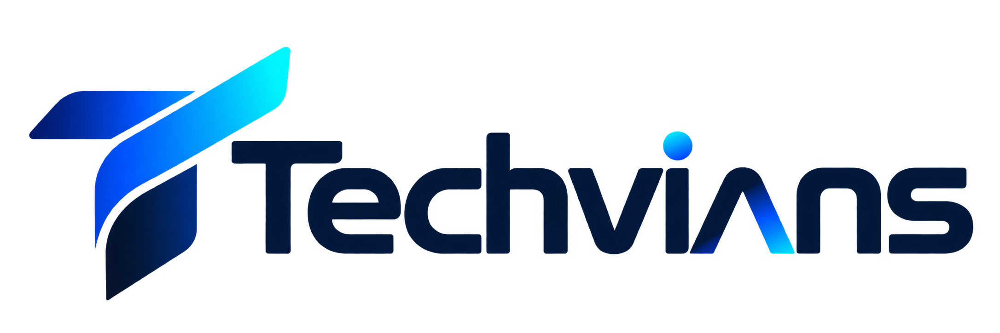

# Techvians

**We design, build and ship AI agents, web platforms and mobile apps — with AI-powered delivery and weekly sprints.**

[Website](https://techvians.com) · [Services](https://techvians.com/services) · [Process](https://techvians.com/process) · [Contact](https://techvians.com/contact)

---

## 👋 Who we are

Techvians is a product engineering team. We turn ideas into working software: intelligent agents that take real actions, platforms that scale, and apps people enjoy using. AI is built into how we work, so our projects move from idea to release in weeks instead of months.

## 🧩 What we build

| | Service | What it covers |
|---|---|---|
| 🤖 | **AI Agents** | Task-running agents with tools, memory and guardrails. MCP and A2A integrations, cloud or self-hosted |
| 🌐 | **Web Platforms** | Marketing sites, dashboards, portals and SaaS products |
| 📱 | **Mobile Apps** | Cross-platform iOS and Android apps built with Flutter |
| ⚙️ | **Automation** | Workflow automation that connects your tools and removes manual work |
| ☁️ | **Cloud & DevOps** | Infrastructure, CI/CD, monitoring and secure deployments |
| 🎨 | **Product Design** | UX research, UI design and design systems |

## 🛠️ Our stack

**AI & agents:** Claude Agent SDK · OpenAI Agents SDK · LangGraph · CrewAI · Google ADK · Microsoft Agent Framework · Hermes Agent · n8n · MCP · A2A

**Web & mobile:** Flutter · Dart · React · Next.js · Node.js · Express

**Cloud & data:** Firebase · Docker · GitHub Actions

## 🔄 How we work

1. **Discover**: understand the goal, users and constraints
2. **Design**: shape the product and agree on scope
3. **Build**: AI-assisted development in weekly sprints, with a demo every week
4. **Launch**: ship, monitor and hand over cleanly
5. **Grow**: support, iterate and scale

## 🤝 Work with us

Have a project in mind? We usually reply within one working day.

- 🌍 Website: [techvians.com](https://techvians.com/contact)

## 🌱 Contributing

Found an issue in one of our public repositories? Open an issue or a pull request. We review contributions every week.

© Techvians. Built with care.

